# Atrium

**An employee self-service portal where every request shows whose desk it is on:** training,
travel, company devices, onboarding and offboarding, and company news, in one calm Nuxt app.

[](https://github.com/martenackermann/atrium-frontend-demo/actions/workflows/ci.yml)
[](./LICENSE)


**[Live demo](https://atrium-workplace.vercel.app)** · runs entirely in your browser, pick any persona
to sign in · **[Backend repository](https://github.com/martenackermann/atrium-backend-demo)**
(NestJS API)

<picture>
  <source media="(prefers-color-scheme: dark)" srcset="docs/screenshots/home-dark.png">
  
</picture>

## About this project

Atrium is a clean-room re-engineering of an internal employee portal, built as a portfolio demo.
All people, companies and data are fictional: the company is "Acme IT Services", and every
address uses the reserved `example.com` domain. Every integration is local or mocked. In the live
demo the whole API runs in your browser, and sign-in uses demo personas instead of a corporate
identity provider.

## Contents

- [What it is](#what-it-is)
- [Feature tour](#feature-tour)
- [Why this stack](#why-this-stack)
- [Design system](#design-system)
- [Architecture](#architecture)
- [Demo personas](#demo-personas)
- [Quick start](#quick-start)
- [Testing](#testing)
- [Project structure](#project-structure)
- [Contributing](#contributing)
- [License](#license)

## What it is

Employees use Atrium to ask for things: a training course, a car rental or a train ticket, a new
colleague's onboarding. Managers approve, and back-office desks book, assign and close. Atrium
makes that journey visible. Every request carries a **routing slip**
("With Max Manager since 08:41"), approval rules are explained while you fill in the form, and
everything that needs you is marked in one place.

| Module              | For employees                                                      | For approvers and desks                                                                 |
| ------------------- | ------------------------------------------------------------------ | --------------------------------------------------------------------------------------- |
| **My day**          | Today's to-dos with inline actions, open requests, upcoming dates  | Queue counts for each desk                                                              |
| **Inbox**           | Updates on your requests                                           | One list of approvals, bookings and replies across modules, with keyboard shortcuts     |
| **Training**        | Request a course, feedback in three rounds, learning goals         | Manager and executive approvals, the training office's booking queue, feedback overview |
| **Travel**          | Car rental, train and flight steppers with a live approval preview | Approvals, the travel desk's booking queue with confirmations and PINs, car classes     |
| **Devices**         | Accept or decline assigned devices                                 | Dashboard, inventory, catalogue, assignment, repair and scrap with a change history     |
| **People requests** | Onboarding and offboarding requests, replies to questions          | The people-ops queue with internal notes and personal data                              |
| **News**            | Articles and useful links                                          | Editor with scheduling, cover images and a links list                                   |
| **Admin**           |                                                                    | Users and roles, audit log, job runner                                                  |

## Feature tour

### My day and the inbox

The home page greets you and lists what needs you today, most urgent first. Each row can be
handled where it stands: accept a laptop, grade a training, write learning goals. Approvers get
the same items in the **Inbox**, a split view built for speed: `J`/`K` to move, `A` to approve,
`D` to decline with a reason, and "Why you're seeing this" on every item (direct report, escalated
past a site manager, or as someone's deputy).

<picture>
  <source media="(prefers-color-scheme: dark)" srcset="docs/screenshots/approvals-dark.png">
  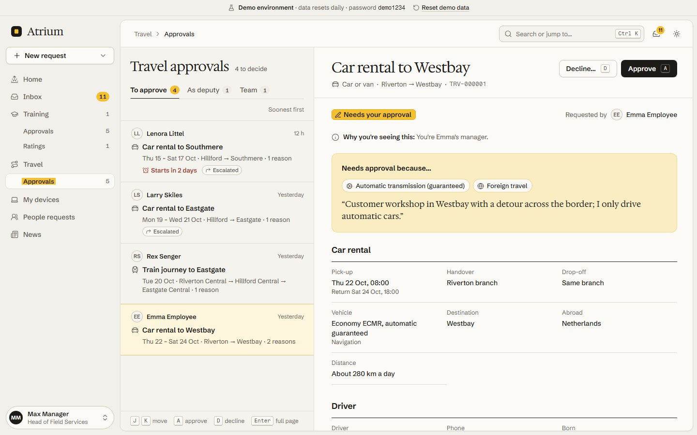
</picture>

### Travel: rules explained before you submit

Requests are written in a focused stepper. The summary slip on the right previews the approval
route from the server's own rules, so a choice like an automatic gearbox or foreign travel shows
"Needs approval because..." while you are still choosing. Economy with a manual gearbox goes
straight to the travel desk.

<picture>
  <source media="(prefers-color-scheme: dark)" srcset="docs/screenshots/car-stepper-dark.png">
  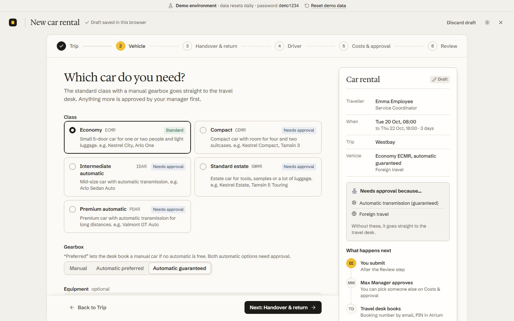
</picture>

The travel desk books from its queue: high-priority trips first, booking confirmation as a PDF,
the booking PIN stored encrypted and shown to the traveller on demand.

<picture>
  <source media="(prefers-color-scheme: dark)" srcset="docs/screenshots/travel-desk-dark.png">
  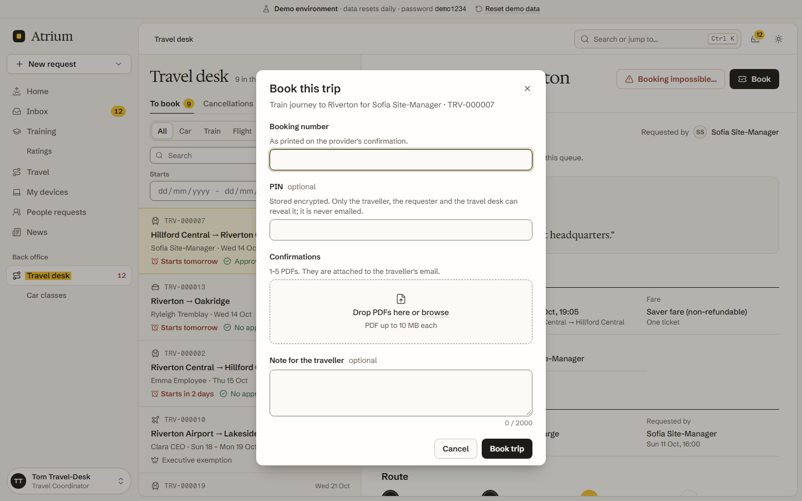
</picture>

### Training: from request to feedback

Training requests go to the manager, then to an executive from €5,000. The training office books,
handles cancellations and tracks billing. After the course, attendees give feedback in three
rounds, and the office sees who is overdue.

<picture>
  <source media="(prefers-color-scheme: dark)" srcset="docs/screenshots/training-office-dark.png">
  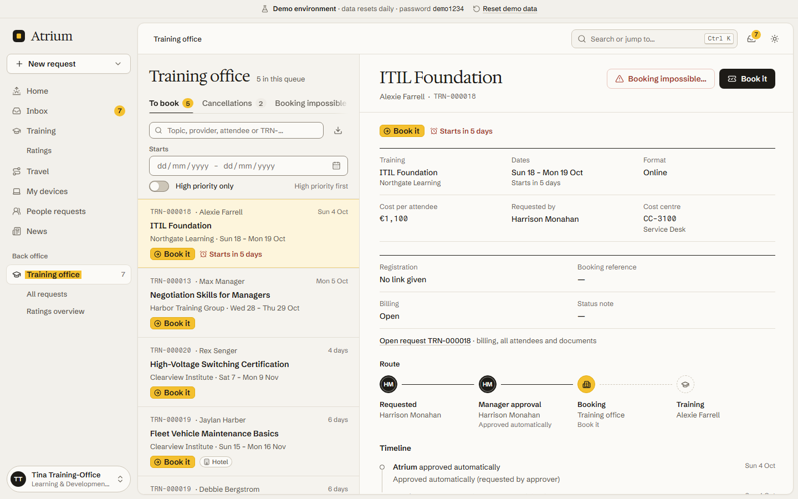
</picture>

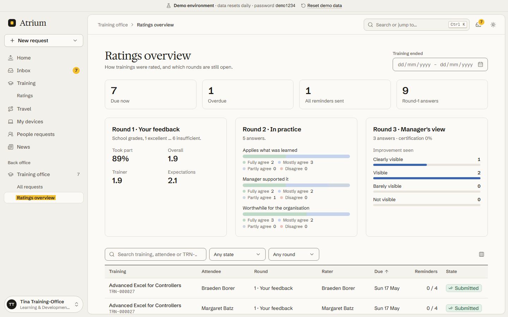

### Devices

Asset admins see what needs attention (devices waiting for acceptance, repairs, stock by type),
assign devices to employees, and get a field-by-field history for every device.

<picture>
  <source media="(prefers-color-scheme: dark)" srcset="docs/screenshots/assets-dashboard-dark.png">
  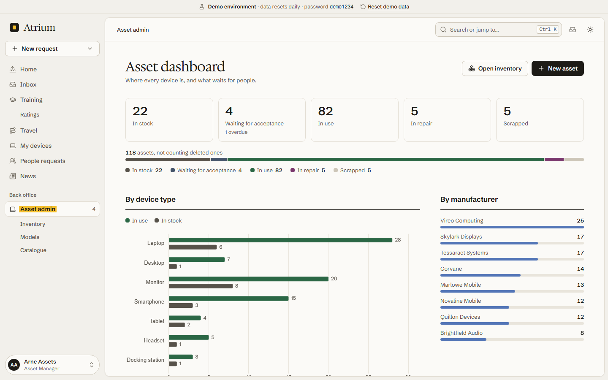
</picture>

### People requests and news

People ops works onboarding and offboarding requests from one queue, asks the requester questions,
and keeps internal notes. Personal data is visible to people ops only. News editors schedule
articles; employees read them in a calm, serif layout.

<picture>
  <source media="(prefers-color-scheme: dark)" srcset="docs/screenshots/people-queue-dark.png">
  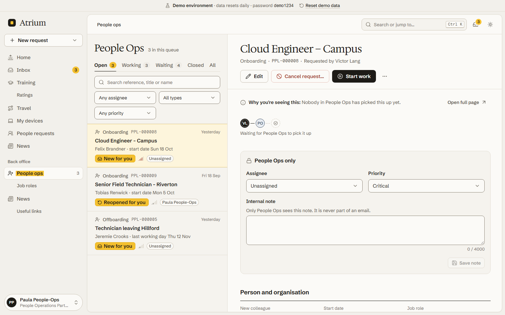
</picture>

<picture>
  <source media="(prefers-color-scheme: dark)" srcset="docs/screenshots/news-article-dark.png">
  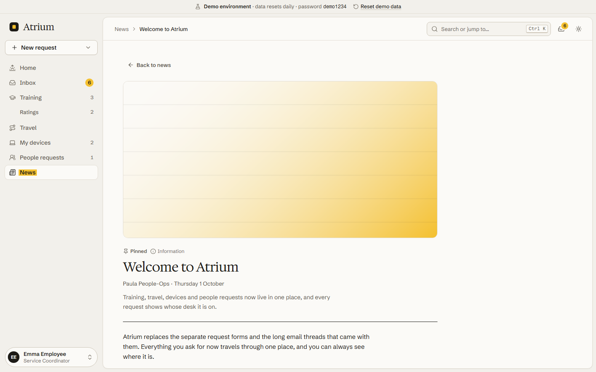
</picture>

### Sign in as anyone, on any screen

The demo signs in with a persona card; the account menu switches persona at any time. On a phone,
the sidebar becomes a tab bar with a central "New" button, and detail views get a sticky action
bar.

<picture>
  <source media="(prefers-color-scheme: dark)" srcset="docs/screenshots/login-dark.png">
  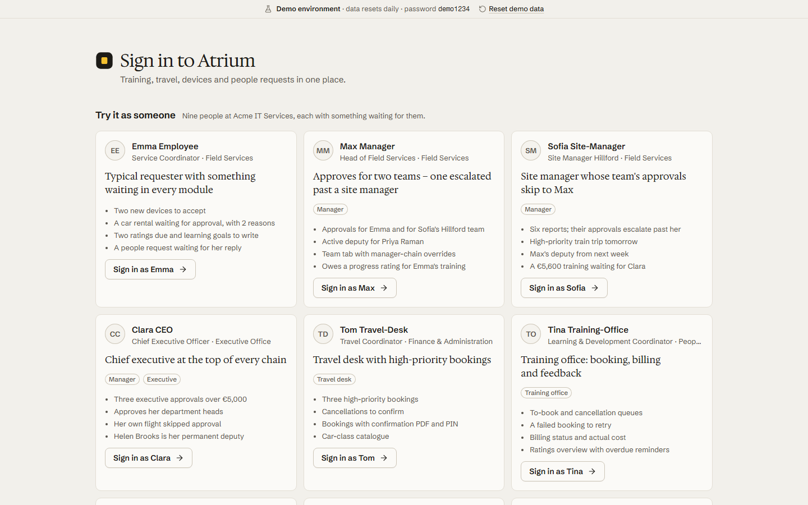
</picture>

<p>
  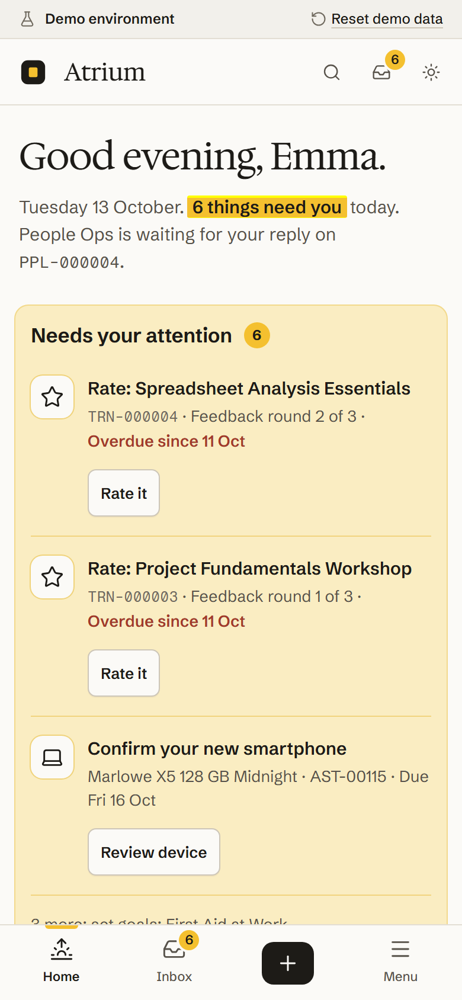
  &nbsp;
  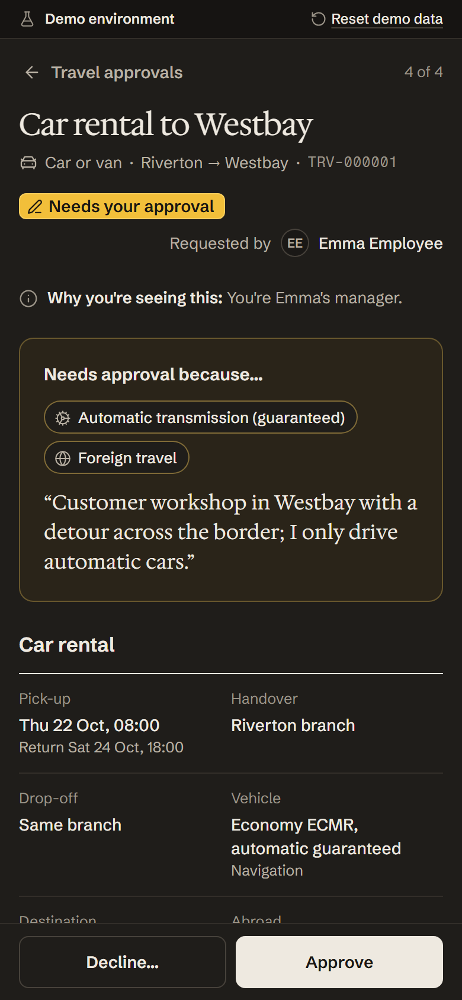
</p>

## Why this stack

Atrium is a signed-in portal with many pages, many forms and six modules that were built in
parallel. The stack is chosen for that job.

| Tool                   | Why it is here                                                                                                                                                                                                                                                                                                                                                                            |
| ---------------------- | ----------------------------------------------------------------------------------------------------------------------------------------------------------------------------------------------------------------------------------------------------------------------------------------------------------------------------------------------------------------------------------------- |
| **Nuxt 4, SPA mode**   | Every page needs the signed-in user's data and nothing needs SEO, so server rendering would add a server without a benefit: `ssr: false` builds a static app that any CDN can host. Nuxt still brings file-based routing for 47 pages, where each module owns its own folder and modules never collide, plus layouts, route middleware for access rules, auto-imports and runtime config. |
| **Reka UI**            | Headless, accessible primitives (dialog, menu, combobox, tabs, popover, date fields) with focus management and keyboard support built in. They carry no styling, so the kit looks like the design system instead of a theme being overridden.                                                                                                                                             |
| **Tailwind CSS v4**    | The design tokens (`tokens.css`) are mapped into a CSS-first `@theme`, and the default palette is removed, so only design tokens can be used. Dark mode swaps the tokens on `html[data-theme]`; components almost never need a `dark:` variant.                                                                                                                                           |
| **TanStack Vue Query** | Server state with a cache per module (`createQueryKeys`). Every successful mutation refreshes the cross-module summary (inbox, counts, My day), so badges never go stale; a `409` refetches the record; list filters, sort and page live in the URL.                                                                                                                                      |
| **vee-validate + zod** | Typed forms, including multi-step steppers that validate step by step and save a draft in the browser. Validation problems from the API (`422` with dot paths such as `attendees.0.userId`) are mapped back onto the right fields.                                                                                                                                                        |
| **MSW demo mode**      | With `NUXT_PUBLIC_DEMO_MODE=msw` a service worker answers every API call from an in-browser database (localStorage), seeded with the same people, ids and story records as the backend seed, and run by a small workflow engine that returns the API's errors in the API's order. That is why the live demo is fully interactive without a server. The same handlers run in Vitest.       |

Also used: openapi-fetch and openapi-typescript (types from the backend's OpenAPI document), Pinia
for the session, TipTap and DOMPurify for news, Chart.js for the device dashboard, Lucide icons,
Vitest and Playwright.

## Design system

Atrium is designed as a desk where requests pass between hands.

- **Paper and ink.** A warm desk ground, a lighter sheet where the work happens, ink-dark type and
  hairline rules. Primary buttons are ink, never colour.
- **The marker.** One saffron accent, used only for "this needs you": the to-do region on My day,
  the inbox count, the current step, the selected row, unread dots. A screen where nothing needs
  you has almost no saffron.
- **The routing slip.** Every request shows its route as monogram stamps on a ruled line. Inked
  stamps have signed, the marked stamp is where the request sits now, dashed stamps are still
  ahead. Status text names people, not states: "With Max Manager since 08:41".
- **Type.** [Schibsted Grotesk](https://fonts.google.com/specimen/Schibsted+Grotesk) for the
  interface, [Hedvig Letters Serif](https://fonts.google.com/specimen/Hedvig+Letters+Serif) for
  greetings, titles and headlines, [Fragment Mono](https://fonts.google.com/specimen/Fragment+Mono)
  for references and amounts (`TRV-000031`, `€1,890`). Self-hosted through Fontsource.
- **Seven status tones** (neutral, waiting, you, moving, positive, negative, blocked), each with an
  icon and a word, so colour never carries meaning alone. Light and dark themes with measured
  contrast, visible focus rings, and reduced motion respected everywhere.
- **Voice.** A competent colleague at the next desk: sentence case, a verb on every button, rules
  explained at the moment they apply, empty states that teach one thing.

The kit lives in `app/components/` (`ui/`, `form/`, `data/`, `workflow/`, `stepper/`, `app/`);
the tokens are in `app/assets/css/tokens.css`.

## Architecture

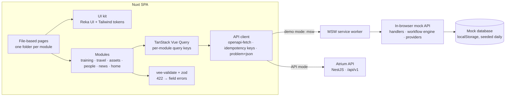

**Modules plug into the shell.** A module is a folder in `app/modules/<name>/` with its API
composables, components, nav badges, commands, mock handlers, mock seed and mock providers. The
shell collects them with `import.meta.glob`, so adding a module never touches shared files. The
navigation, the inbox drawer, the ⌘K palette, search and My day are filled from these registries.

**Demo mode mirrors the API.** The mock layer has the same shape as the backend: handlers per
endpoint, a workflow engine per stateful record, and providers that feed the inbox, search, counts
and My day. Mock data is generated relative to today, so due dates and reminders stay realistic,
and "Reset demo data" in the demo ribbon starts over.

## Demo personas

Sign in on the login page by picking a card. The password for every persona is `demo1234`, which
exists only for the demo.

| Persona              | Role                    | Try this                                                                                                          |
| -------------------- | ----------------------- | ----------------------------------------------------------------------------------------------------------------- |
| Emma Employee        | Employee                | Accept a laptop on My day, give feedback on a training, start a car rental and watch the approval reasons appear. |
| Max Manager          | Manager                 | Approve from the inbox with `A`, decline with a reason, act as Priya's deputy, rate Emma's training in round 3.   |
| Sofia Site-Manager   | Site manager            | See why her team's requests escalate past her to Max.                                                             |
| Clara CEO            | Executive               | Approve trainings above €5,000; her own flight needed no approval.                                                |
| Tom Travel-Desk      | Travel desk             | Book a high-priority trip with a confirmation PDF and a PIN; edit the car-class catalogue.                        |
| Tina Training-Office | Training office         | Book trainings, handle a cancellation, retry an impossible booking, check overdue feedback.                       |
| Arne Assets          | Asset admin             | Assign a device, send one to repair, read a device's change history.                                              |
| Paula People-Ops     | People ops, news editor | Work the people-ops queue, ask a requester a question, schedule a news article.                                   |
| Ian IT-Admin         | IT admin                | Change roles, read the audit log, run a reminder job. Sees every back office but cannot approve.                  |

## Quick start

Requirements: Node 22.12 or newer (CI and Vercel use Node 24) and pnpm 10.

```bash
pnpm install
pnpm dev:demo        # http://localhost:3000 in demo mode: no backend needed
```

### Against the backend

Start the [Atrium API](https://github.com/martenackermann/atrium-backend-demo) (for example
`docker compose up --build` in that repository), then:

```bash
cp .env.example .env # API at http://localhost:3100/api/v1, demo mode "api" (persona sign-in)
pnpm dev             # http://localhost:3000
```

With `NUXT_PUBLIC_DEMO_MODE=api` the app talks to the real API, still offers the persona cards,
and the demo ribbon links to the Mailpit inbox where every email lands. Leave the variable empty
for a plain production build.

| Variable                  | Default                        | Purpose                                                                    |
| ------------------------- | ------------------------------ | -------------------------------------------------------------------------- |
| `NUXT_PUBLIC_API_BASE`    | `http://localhost:3100/api/v1` | Base URL of the API (`/api/v1` in the static demo)                         |
| `NUXT_PUBLIC_DEMO_MODE`   | (empty)                        | `msw` = in-browser API, `api` = real API with persona sign-in, empty = off |
| `NUXT_PUBLIC_MAILPIT_URL` | `http://localhost:8025`        | "Open demo mailbox" link in the demo ribbon                                |

### Static demo build

```bash
pnpm build:demo      # demo mode baked in, output in .output/public
pnpm preview:demo    # serve it with SPA fallback on http://localhost:4173
```

The live demo is this build on Vercel: [`vercel.json`](./vercel.json) runs `pnpm build:demo`,
serves `.output/public` and rewrites every route to `index.html`.

### Scripts

| Script                           | What it does                                           |
| -------------------------------- | ------------------------------------------------------ |
| `pnpm dev` / `pnpm dev:demo`     | Dev server on port 3000 (real API / demo mode)         |
| `pnpm build` / `pnpm build:demo` | Production build / static demo build                   |
| `pnpm preview:demo`              | Serve the static demo build with SPA fallback          |
| `pnpm lint` / `pnpm lint:fix`    | ESLint + Prettier check (or fix)                       |
| `pnpm typecheck`                 | `vue-tsc` through `nuxt typecheck`                     |
| `pnpm test` / `pnpm test:e2e`    | Vitest / Playwright                                    |
| `pnpm screenshots`               | Regenerate the screenshots in `docs/screenshots/`      |
| `pnpm api:types`                 | Regenerate API types from the backend's `openapi.json` |
| `pnpm mocks:users`               | Copy the backend's seeded org into the mock data       |

## Testing

```bash
pnpm test                    # Vitest: unit (node) + nuxt (components in a Nuxt runtime)
pnpm test:e2e                # Playwright against the demo dev server (port 3210)
E2E_STATIC=1 pnpm test:e2e   # Playwright against the static demo build (pnpm build:demo first)
```

- **Unit tests** (`test/unit`) cover the workflow rules, list queries, the stepper logic and the
  mock API, called through the real HTTP client against the MSW handlers in Node.
- **Component tests** (`test/nuxt`) mount kit components inside the Nuxt runtime with happy-dom.
- **End-to-end tests** (`test/e2e`) sign in as personas and walk through each module in demo mode.
  `integration.spec.ts` chains the cross-module flows persona by persona: Emma requests, Max
  approves, the desks book, Emma sees the result.
- **The same flows against the real API:** start the backend (`pnpm demo:reset` for fresh data)
  and the app with `NUXT_PUBLIC_DEMO_MODE=api`, then run

  ```bash
  PLAYWRIGHT_BASE_URL=http://localhost:3000 E2E_API=1 E2E_MAILPIT_URL=http://localhost:8025 \
    pnpm exec playwright test --project=chromium --workers=1 test/e2e/integration.spec.ts
  ```

CI ([`.github/workflows/ci.yml`](./.github/workflows/ci.yml)) runs lint, typecheck, Vitest, the
static demo build, and the end-to-end suite against that build.

## Project structure

```
app/
  pages/              file-based routes: one folder per module, back-office/, admin/, settings/
  modules/<name>/     training, travel, assets, people, news, home:
                        api/ (types + Vue Query composables), components/, badges.ts,
                        commands.ts, mocks/ (seed, handlers, providers)
  components/         the UI kit: ui/ form/ data/ workflow/ stepper/ app/ (shell)
  composables/        useApi, useListQuery, useStepper, useWorkflowAction, useConfirm, ...
  lib/                framework-free logic: API client and errors, access rules, status, list queries
  mocks/              MSW setup, mock database, workflow engine, core org and handlers
  assets/css/         tokens.css (design tokens) + main.css (Tailwind theme, base, motion)
  config/             navigation
  middleware/         auth and access guards
test/
  unit/  nuxt/  e2e/  Vitest unit, Vitest + Nuxt runtime, Playwright
scripts/              API types, mock users, static server
docs/screenshots/     the screenshots in this README (pnpm screenshots)
```

## Contributing

[`CONVENTIONS.md`](./CONVENTIONS.md) explains the module system, API usage, forms, mocks and tests,
and records the decisions behind them.

## License

[MIT](./LICENSE) © 2026 Marten Ackermann
